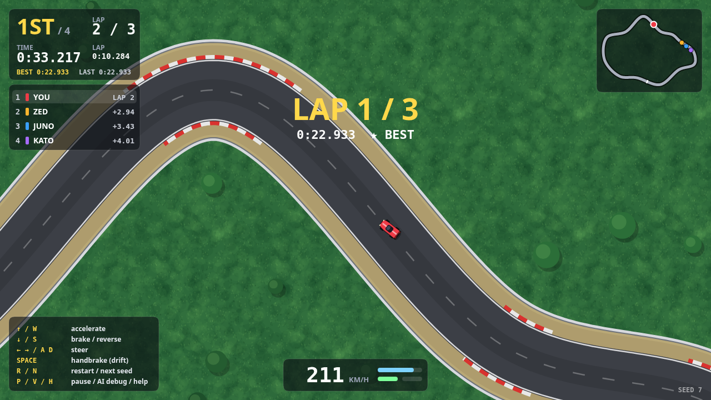

# Top-Down Arcade Racer

A small, dependency-free top-down 2D racing prototype in plain JavaScript (Canvas 2D).



| Requirement | Where / how |
|---|---|
| Player car with acceleration / braking / steering | `src/car.js` — rigid body + tyre model, keyboard input in `src/main.js` |
| 3 AI opponents (A\* or waypoint following) | `src/ai.js` — waypoint following on a computed racing line with a braking/accel speed profile |
| Lap detection | `src/race.js` + `Track.gateCrossing` — ordered full-width checkpoint gates, sub-tick crossing times, anti-shortcut |
| Collision response with simple impulse resolution | `src/collision.js` — normal + friction impulses, linear *and* angular, car↔car and car↔barrier |
| HUD: lap / time / position | `src/render.js` — position, lap, race/lap/best/last time, live standings with time gaps, minimap, speed |
| Deterministic RNG seed | `src/rng.js` (mulberry32 + forkable streams); the seed drives the track, grid order and AI personalities |
| Fixed timestep | `src/loop.js` — accumulator, `dt = 1/120 s`, render interpolation |
| No physics engine | everything is hand-written; zero dependencies |

## Run it

Open `index.html` in a browser (works from `file://` — plain `<script>` tags, no modules/bundler).
Or serve the folder: `python3 -m http.server 8080` → <http://localhost:8080>.

| Key | Action |
|---|---|
| ↑ / W | accelerate |
| ↓ / S | brake, then reverse |
| ← → / A D | steer |
| Space | handbrake (drift) |
| R / N | restart same seed / next seed |
| P | pause |
| V | AI debug view (racing line coloured by target speed, gates, collider circles, aim points) |
| H | toggle help |

URL parameters: `?seed=<number|text>` `&laps=<n>` `&auto=1` (attract mode: AI drives your car) `&debug=1` `&skip=<seconds>` (fast-forward the sim).
`N` rewrites `?seed=` in the address bar, so a link reproduces the same race.

## Tests

```
node test/run.js        # 49 checks, ~3 s, no dependencies
node tools/report.js 1 12   # headless AI-only races: lap times, contacts, stuck events
```

The suite covers the RNG, track validity over many seeds, car dynamics, impulse maths (analytic
solution, momentum/angular-momentum conservation, barrier containment), lap detection and
anti-cheat, AI behaviour (finishing, overtaking, recovery), bit-exact determinism and
frame-rate independence. I also mutation-checked the lap-gate and restitution tests (they fail
when those behaviours are broken).

## Design notes

**Determinism.** The simulation (`race.js` and below) has no DOM, no `Math.random`, no `Date`,
no `performance.now` — a test traps all of them. Inputs are the seed plus one input object per
tick, so the same seed and inputs give bit-identical states (`Race.stateHash()`; shown with `V`).
`RNG.fork(label)` derives independent streams (track, grid, AI, cosmetics), so adding a random
call to one subsystem never shifts another. Cosmetics (particles, camera shake, trees) use their
own seeded stream and never feed back into the sim. Bit-exactness is per JS engine: `sin`/`cos`/`exp`
are not specified to the last ulp across engines.

**Fixed timestep.** `FixedStepper` consumes real frame time and runs a whole number of
`1/120 s` ticks (frame time clamped to 0.25 s). The renderer interpolates each car between its
previous and current tick pose (`alpha`), so motion is smooth at 30, 60 or 144 Hz while the
physics never sees the frame rate.

**Track.** Generated from the seed: random star-shaped control points → centripetal Catmull–Rom
→ arc-length resampling → light smoothing. Candidates are rejected if a corner is tighter than
150 px radius, two far-apart strands come within 262 px, or the lap is outside 8000–13000 px, so
every seed is drivable (seeds 1–40 are tested; a fixed fallback shape exists). The start line is
placed in the straightest stretch, and half of the seeds run the other way round.
Closest-point queries search a small window around each car's last index, so a car at a hairpin
can never snap to the wrong strand.

**Car model.** State: position, heading, velocity, yaw rate. Each tick the velocity is split into
forward/sideways components: the engine tapers towards top speed, brakes double as reverse, and
the tyres remove sideways velocity but only up to a friction budget (shared with the longitudinal
force through an ellipse). Past the budget the car slides — understeer, or a drift with the
handbrake. Steering lock shrinks with speed so full lock asks for about the grip limit. Grass
cuts top speed and grip.

**Collisions.** Each car is a row of four overlapping circles (a cheap, robust stand-in for a
rounded rectangle). For a contact with normal *n* the solver applies
`j = −(1+e)(v_rel·n) / (1/mA + 1/mB + (rA×n)²/IA + (rB×n)²/IB)` at the contact point (so hits
create spin), followed by a Coulomb friction impulse, a few sequential passes for stacked contacts
and a slop-based positional correction. The barrier is a static wall at a fixed distance from the
centreline, so wall contact is just "distance to centreline + radius > limit".

**Lap detection.** 8 full-width gates; a car must cross them in order (`cp` counts crossings) and a
lap completes when gate 0 is crossed with `cp = k·8 + 1`. Crossing a gate backwards un-counts it, so
reversing over the line can't be farmed and skipping sectors doesn't count. Crossing times are
interpolated inside the tick. Standings sort finished cars by finish time, others by unrolled
distance along the track. Time gaps come from "when did that car reach this point" buckets.

**AI.** `buildRacingLine` relaxes a lateral offset per sample (clamped inside the asphalt) so the
path straightens through corners; a speed profile (corner speed from curvature and the tyre
budget, then backward/forward passes for braking and acceleration limits) tells the AI how fast
it can go at every waypoint. Each tick the driver pure-pursuits a point ahead on the line, follows
the speed profile with a throttle/brake controller, shifts its aim sideways to pass or avoid other
cars (choosing the side with room), and runs a short reverse manoeuvre if it gets stuck. It uses
the same `Car` and the same input object as the player — no extra grip or power. Each driver gets a
seeded pace and line bias; a mild rubber band (±3.5 %, `CONFIG.AI.rubber`, `0` disables it) keeps
the race close to the human. After the flag the finishing car (including yours) is taken over by
the autopilot at a cool-down pace.

## Tuning

Everything is in `src/config.js`: car power/grip, steering, collision restitution/friction, track
size and constraints, AI aggression, rubber band, race length.

## Files

```
index.html          page + script order
src/config.js       all tunables
src/rng.js          seeded RNG, forkable streams
src/track.js        track generation, queries, gates
src/car.js          vehicle dynamics
src/collision.js    impulse resolution
src/ai.js           racing line, speed profile, driver
src/race.js         grid, countdown, tick pipeline, laps, standings
src/loop.js         fixed-timestep accumulator
src/render.js       canvas renderer + HUD (read-only view of the sim)
src/main.js         input + requestAnimationFrame glue
test/               headless tests        tools/  AI race report
```
